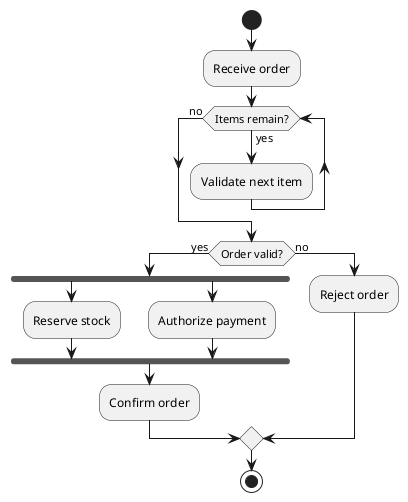

# Activity Diagram Specification

## Purpose and Selection

Show actions, decisions, loops, and parallel work in a process. Choose this view for workflow logic; use [sequence](sequence_spec.md) for messages among participants or [state](state_spec.md) for one entity's lifecycle.

## Required Inputs

Identify start condition, actions, decision guards, branch outcomes, loop exit conditions, parallel tasks, and responsible roles when ownership matters. Do not invent decision criteria.

## Modeling Rules

- Use the current activity syntax: `start`, `:Action;`, `if (...) then (...)`, `else (...)`, `endif`, and `stop`. Actions are surrounded by colons and end with a semicolon; parentheses belong to guards.
- A branch may merge at `endif` and continue. Give every decision a clear path for relevant outcomes. Use `while (condition) is (yes)` / `endwhile (no)` for a precondition loop, or `repeat` / `repeat while (condition)` for a postcondition loop.
- Use `fork`, `fork again`, and `end fork` for work that can run in parallel and later joins. Use `|Role|` swimlanes only when ownership is known.
- Prefer structured branches and loops. Avoid experimental `goto` / `label` routing for normal diagrams.

## PlantUML Syntax

Indent nested actions and close each control block. See the [PlantUML activity reference](https://plantuml.com/activity-diagram-beta).

## Complete Example

## Semantic Acceptance Checks

- Every action and guard maps to a requirement; branches cover the intended outcomes.
- Loops have a reachable exit and parallel work joins only when synchronization is required.
- Each swimlane, if used, reflects a known owner; process flow is not confused with state transitions.

## Output Contract

For a generation request, return one complete `plantuml` block. Ask about missing essential facts first; list nonessential assumptions outside the block.
