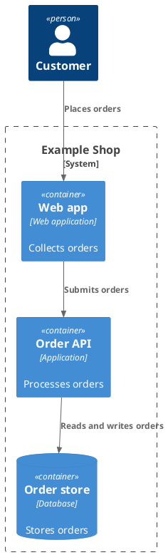

# C4 Container Diagram Specification

## Purpose and Selection

Show the logical building blocks of one software system and how they interact with people or external systems. A C4 container is an independently running or storing application/data unit; it does not necessarily mean a Docker container. Use [deployment](deployment_spec.md) to place these units on hosts, pods, or networks.

## Required Inputs

Identify the software system in scope, its users, logical applications and data stores, external dependencies, responsibilities, and supported interactions. Ask before inventing a technology stack or protocol.

## Modeling Rules

- Put in-scope containers inside `System_Boundary`; keep external people and systems outside. The boundary represents ownership of one software system, not a subnet, trust zone, or Kubernetes namespace.
- Give every container one clear responsibility and stable alias. Use `ContainerDb` for a logical data store and `ContainerQueue` for a logical broker when supported by the source.
- Use `Rel(source, target, "Purpose")`; include the optional fourth technology/protocol argument only when known. Label relationships with what is exchanged or why, not vague verbs such as “connects.”
- Stay at the container abstraction level. Do not add classes, physical hosts, firewall rules, or assumed deployment replicas.

## PlantUML Syntax

Start with `!include <C4/C4_Container>`. This relies on the C4 entry in PlantUML's bundled standard library; verify the renderer has it. No remote `!include` is needed. See the [C4 standard-library example](https://github.com/plantuml/plantuml-stdlib#c4-library-c4-plantuml-c4).

## Complete Example

## Semantic Acceptance Checks

- The software boundary and every container responsibility match the supplied system description.
- Relationships have justified direction and purpose; technology labels appear only when known.
- External systems remain outside, and no physical infrastructure is presented as a logical container.

## Output Contract

For a generation request, return one complete `plantuml` block. Ask about missing essential facts first; list nonessential assumptions outside the block.
