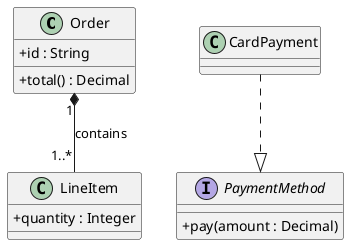

# Class Diagram Specification

## Purpose and Selection

Show static types, attributes, operations, and relationships. Choose this view for domain or object-oriented structure. A conceptual data model can use class notation, but physical tables, keys, and database constraints need an explicit data-model scope.

## Required Inputs

Identify types, known members and types, inheritance or interface contracts, associations, ownership, and supported multiplicities. Ask before inferring a composition lifecycle or cardinality.

## Modeling Rules

- Use `class`, `abstract class`, `interface`, or `enum` according to actual type semantics. Avoid translating each database table into a class without deciding the intended level of detail.
- Use `Child --|> Parent` for inheritance and `Implementation ..|> Interface` for realization. A filled diamond belongs at the **whole** end of composition (`Whole *-- Part`); an open diamond denotes weaker aggregation. Use plain association when lifecycle ownership is not established.
- Put multiplicities at the correct endpoints, such as `Order "1" *-- "1..*" LineItem`. Include visibility or method signatures only when useful and supported by the source.
- Do not turn an operational sequence or entity lifecycle into static class links.

## PlantUML Syntax

Declare named types and connect aliases with `--`, `-->`, `--|>`, `..|>`, `*--`, or `o--` as appropriate. See the [PlantUML class reference](https://plantuml.com/class-diagram).

## Complete Example

## Semantic Acceptance Checks

- Types and members correspond to supplied domain or code facts; names are stable and unambiguous.
- Arrowheads, diamonds, endpoint multiplicities, and ownership match the intended model.
- Static structure is kept separate from process order and deployment placement.

## Output Contract

For a generation request, return one complete `plantuml` block. Ask about missing essential facts first; list nonessential assumptions outside the block.
