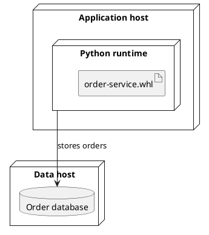

# Deployment Diagram Specification

## Purpose and Selection

Show where deployable artifacts and execution environments live. Choose this view when the question names hosts, virtual machines, pods, network segments, or artifact placement. Use [C4 container](c4_container_spec.md) for logical application responsibilities without physical placement.

## Required Inputs

Identify the deployment environment, nodes, runtime environments, artifacts or running instances, and known connections. Ask before adding IP addresses, ports, resource sizes, replicas, or security boundaries.

## Modeling Rules

- Use nested `node` blocks for actual execution containment. Put an `artifact` within the node or runtime where it is deployed. A file artifact is not itself a running service instance.
- Use `cloud`, `database`, or `queue` shapes only when they communicate known infrastructure roles. Put a connection between known endpoints and label its purpose or protocol if known.
- Distinguish environments or replicas only when the source identifies them. Ports and interface pins are optional details, not required decoration.
- Line thickness, dashes, and colors are presentation choices; they do not establish bandwidth, security, or transport semantics.

## PlantUML Syntax

Use `node "Label" as Alias { ... }`, `artifact "Package" as Alias`, and explicit links such as `Runtime --> Database : purpose`. See the [PlantUML deployment reference](https://plantuml.com/deployment-diagram).

## Complete Example

## Semantic Acceptance Checks

- Every artifact is placed on the intended runtime or node; connections match documented deployment facts.
- Logical service names are tied to deployable instances without assuming hosts or replicas.
- Addresses, ports, protocols, security zones, and resources appear only when the input supplies them.

## Output Contract

For a generation request, return one complete `plantuml` block. Ask about missing essential facts first; list nonessential assumptions outside the block.
