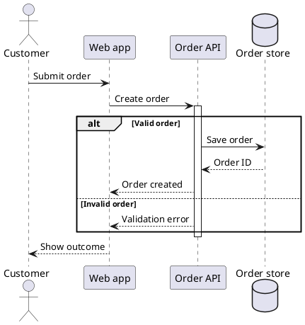

# Sequence Diagram Specification

## Purpose and Selection

Show the order of messages among named participants in one scenario. Choose this view for request/response, event delivery, alternatives, and timeouts; use [activity](activity_spec.md) when the main question concerns process decisions or ownership.

## Required Inputs

Identify scenario trigger, participants, ordered messages, relevant replies, and known success or failure paths. Ask before inventing an endpoint, payload, protocol, or failure behavior.

## Modeling Rules

- Declare participants with stable aliases in display order. Use `actor`, `participant`, `boundary`, `control`, `database`, or `queue` when the shape helps explain the role.
- Label each message with an operation or event. A solid `->` and dashed `-->` can distinguish requests and replies; these line styles do not prove runtime blocking semantics. Use `->>` only when asynchronous delivery is a known fact.
- Use `alt` / `else` / `end` for exclusive outcomes, `opt` for optional behavior, `loop` for repetition, and `par` for concurrent exchanges. Balance every fragment and any `activate` / `deactivate` pair.
- Include error and timeout paths when they change the scenario. Show object creation or destruction only when it is part of the requirements.

## PlantUML Syntax

Write `Sender -> Receiver: message`, `Receiver --> Sender: reply`, and fragment guards after `alt` or `else`. See the [PlantUML sequence reference](https://plantuml.com/sequence-diagram).

## Complete Example

## Semantic Acceptance Checks

- Message order, sender, receiver, and labels match the scenario evidence.
- Alternative guards describe distinct paths; every fragment and activation closes.
- Replies, missing responses, and timeouts reflect known behavior rather than an assumed happy path.

## Output Contract

For a generation request, return one complete `plantuml` block. Ask about missing essential facts first; list nonessential assumptions outside the block.
