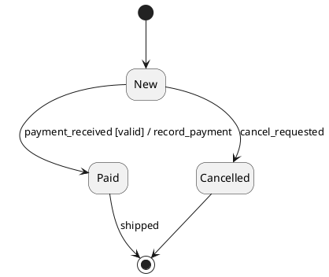

# State Diagram Specification

## Purpose and Selection

Show the allowed lifecycle of one entity, including states and transitions. Choose this view when the question is which status an entity can enter and what event or condition moves it there; use [activity](activity_spec.md) for the steps of a process.

## Required Inputs

Identify the entity, initial state, valid states, transition triggers, guards, effects, and terminal or continuing behavior. Ask if a transition or terminal outcome is unknown.

## Modeling Rules

- Use one `[*]` initial pseudostate for each state-machine scope. A transition to `[*]` denotes completion in that scope; do not force an end state for a continuing lifecycle.
- Label transitions `event [guard] / effect` when those parts are known. Completion transitions may omit an event. Guard conditions on competing exits should be understandable and noncontradictory.
- Use composite states for meaningful substates. History (`[H]` or `[H*]`) and concurrent regions belong only in a defined composite state with clear resume behavior.
- Keep actions such as `entry`, `do`, and `exit` attached to the state when needed; do not represent them as separate lifecycle states.

## PlantUML Syntax

Use `state "Label" as Alias`, `Source --> Target : event [guard] / effect`, and balanced composite-state braces. See the [PlantUML state reference](https://plantuml.com/state-diagram).

## Complete Example

## Semantic Acceptance Checks

- Every state is reachable from the initial state or is explicitly identified as intentionally unreachable.
- Events, guards, and effects match the entity's real lifecycle; competing guards do not silently overlap.
- Final states and history behavior reflect the intended scope, including whether the entity may continue later.

## Output Contract

For a generation request, return one complete `plantuml` block. Ask about missing essential facts first; list nonessential assumptions outside the block.
