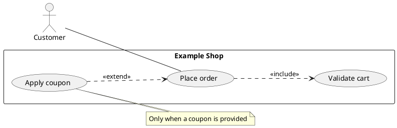

# Use Case Diagram Specification

## Purpose and Selection

Show which external actors pursue which goals within a named software-system boundary. Choose this view for functional scope and access to capabilities; use [sequence](sequence_spec.md) for the steps of a particular scenario.

## Required Inputs

Identify the system name, actors, actor goals, and supported associations. Include `<<include>>` only for a required reused goal and `<<extend>>` only for an optional behavior with a stated condition. Ask when the boundary or actor permissions are unclear.

## Modeling Rules

- Keep actors outside a `rectangle` containing the system's use cases. Name use cases as user-visible goals, not API endpoints or implementation steps.
- Use one alias per actor and use case. An undirected `--` association is sufficient unless direction carries an intended meaning.
- `Base ..> Included : <<include>>` points from the base goal to mandatory included behavior. `Extension ..> Base : <<extend>>` points from optional behavior to its base. Put the extension condition in a note or companion text.
- `Child --|> Parent` models actor or use-case generalization only when the specialized element inherits the parent's role or behavior.

## PlantUML Syntax

Use `actor "Name" as Alias`, `usecase "Goal" as Alias`, `rectangle "System" { ... }`, and explicit relationship endpoints. See the [PlantUML use-case reference](https://plantuml.com/use-case-diagram).

## Complete Example

## Semantic Acceptance Checks

- Every actor is external to the named system; every use case is a goal inside it.
- Associations and include/extend directions match the source requirements; optional behavior has a condition.
- No message chronology, database table, or infrastructure node appears in the view.

## Output Contract

For a generation request, return one complete `plantuml` block. Ask about missing essential facts first; list nonessential assumptions outside the block.
